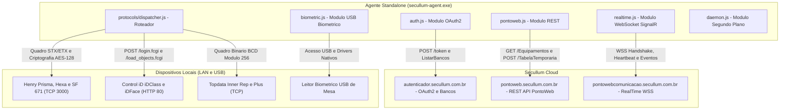

# Secullum RH — Standalone Communication Agent CLI & Executável Autônomo

Um agente de comunicação **100% autônomo**, livre de dependências externas e multiplataforma para **Windows** e **Linux**, desenvolvido através de engenharia reversa com **REA (*Reverse Engineer Anything*)** sobre a suíte oficial do Secullum RH / PontoWeb.

O projeto conecta-se diretamente à **Nuvem Secullum (PontoWeb Cloud)** e aos **Relógios de Ponto (REPs) e Leitores Biométricos** na rede local ou USB.

> [!IMPORTANT]
> **Totalmente Independente:** Não necessita do aplicativo oficial Electron, nem do backend original `.NET` (`PontoWebComunicacaoService`), nem de nenhuma dependência npm externa.
> **Executável Standalone:** Disponível como executável nativo único (`secullum-agent.exe` no Windows e binário ELF no Linux). **Não requer Node.js instalado na máquina cliente.**

---

## 📑 Sumário

1. [Visão Geral & Recursos Principais](#-recursos-principais)
2. [Arquitetura & Engenharia Reversa (REA)](#-arquitetura--engenharia-reversa-rea)
3. [Como Usar o Executável Autônomo (Sem Node.js)](#-como-usar-o-executável-autônomo-sem-nodejs)
4. [Como Usar via Código Fonte (Node.js)](#-como-usar-via-código-fonte-nodejs)
5. [Tutorial Passo a Passo de Utilização](#-tutorial-passo-a-passo-de-utilização)
6. [Protocolos dos Fabricantes de Relógios (REPs)](#-protocolos-dos-fabricantes-de-relógios-reps)
7. [Leitores Biométricos USB de Mesa](#-leitores-biométricos-usb-de-mesa)
8. [Daemonização e Serviço de Sistema Operacional](#-daemonização-e-serviço-de-sistema-operacional)
9. [Como Recompilar o Executável (Build SEA)](#-como-recompilar-o-executável-build-sea)
10. [Tabela Completa de Comandos](#-tabela-completa-de-comandos)

---

## 🌟 Recursos Principais

- ⚡ **Executáveis Autônomos Prontos:** Binários nativos pré-compilados para **Windows (`.exe`)** e **Linux (ELF)** disponíveis diretamente na aba de Releases, com runtime V8 embutido via Node.js SEA (*Single Executable Application*).
- ☁️ **Comunicação Direta com Secullum Cloud:** OAuth2 nativo, API REST PontoWeb e WebSocket RealTime (SignalR / Hub `"Comunicacao"`).
- 🕒 **Coleta Automática de Marcações (AFD / Batidas):** Coleta relatórios de batidas a partir do último NSR dos equipamentos (Portaria 1510 e Portaria 671) e realiza o envio automático para `POST /TabelaTemporaria/false`.
- 👥 **Envio de Novos Funcionários ao REP:** Sincroniza colaboradores cadastrados na nuvem (`GET /Funcionarios`) para a memória interna dos relógios físicos.
- 🖐️ **Captura Ativa no Leitor USB de Mesa:** Suporte a Suprema BioMini, BioMini Adv, Control iD iDBio, LC/Futronic e Nitgen com gauge de qualidade e extração de template ANSI/ISO 378.
- ⏱️ **Sincronização de Data e Hora em Hardware:** Ajuste de relógio em microssegundos com protocolos criptografados nativos (Henry, Control iD, Topdata).
- 🔍 **Sondagem de Rede em Tempo Real:** Medição de latência e detecção de status LAN via sockets TCP puros.
- 🔄 **Daemonização Silenciosa:** Opera em segundo plano como serviço ou daemon com auto-coleta contínua a cada 60s e reconexão automática.
- 🖥️ **Monitor Dashboard ao Vivo:** Interface estilo terminal que replica visualmente o painel oficial Electron.

---

## 🏗️ Arquitetura & Engenharia Reversa (REA)

A arquitetura foi extraída a partir da descompilação de `Secullum.PontoWeb.ServicoComunicacao.exe`, `Secullum.Comunicacao.dll`, `Secullum.Autenticacao.Client.dll` e `Secullum.RealTime.Client.dll`:



### Especificações Técnicas Reversas Descobertas:

1. **OAuth2 e Descoberta de Bancos:**
   - Token Endpoint: `POST https://autenticador.secullum.com.br/token` (`client_id=3`, `grant_type=password`).
   - Listagem de Empresas: `GET https://autenticador.secullum.com.br/ContasSecullum/ListarBancos/{email}` -> Retorna identificadores GUID das empresas vinculadas à conta.
2. **API REST Secullum Cloud (`pontoweb.secullum.com.br`):**
   - Headers Mandatórios: `Authorization: Bearer <token>`, `secullumbancoselecionado: <bancoId>`, `secullumversaoagente: 1.54.0.0`.
   - `/Equipamentos/v2`: Lista de relógios com serial, IP, porta e string de configuração serializada (`Configuracao`).
   - `/Funcionarios`: Base de colaboradores com PIS, CPF, folha e cartões.
   - `/TabelaTemporaria/false`: Inserção direta de marcações AFD (`List<DadosRegistroOffline>`).
3. **Gateway RealTime WebSocket (`wss://pontowebcomunicacao.secullum.com.br/`):**
   - Handshake Inicial: `{"AccessToken": "<jwt>", "Group": "<bancoId>", "ProtocolVersion": 19, "Headers": {}}`.
   - Registro do Agente: Invoca método `EstabelecerConexaoAgente` no Hub `"Comunicacao"` enviando nome da máquina, endereço MAC e lista de equipamentos.
   - Heartbeat: Servidor envia `{"HubName": "--PING--"}` e o cliente responde `{"HubName": "--PONG--"}`.
   - Eventos de Nuvem Atendidos: `EnviarDataHora`, `ReceberRegistros`, `EnviarListaPessoas`, `ListarPessoas`, `CapturarDigital`.

---

## ⚡ Como Usar o Executável Autônomo (Sem Node.js)

### 📥 1. Baixar o Binário Pré-compilado (Releases)

Você não precisa instalar Node.js, compilar código ou configurar dependências. Basta acessar a página de **[Releases](../../releases)** deste repositório e baixar o binário pronto para a sua plataforma:

| Plataforma | Arquivo de Download | Descrição |
|:---|:---|:---|
| **Windows (x64)** | `secullum-agent-windows-x64.exe` | Executável `.exe` portátil para Windows 10, 11 e Windows Server. |
| **Linux (x64)** | `secullum-agent-linux-x64` | Binário nativo ELF para Ubuntu, Debian, CentOS, RHEL, Alpine, etc. |
| **Integridade** | `checksums.txt` | Hashes SHA-256 para verificação de integridade dos binários. |

---

### 🖥️ 2. Executando no Windows

1. Baixe o arquivo `secullum-agent-windows-x64.exe` na aba de **Releases**.
2. Abra o **PowerShell** ou o **Prompt de Comando (CMD)** na pasta onde o arquivo foi baixado.
3. *(Opcional)* Renomeie para `secullum-agent.exe` para facilitar a digitação:
```powershell
Rename-Item .\secullum-agent-windows-x64.exe .\secullum-agent.exe
```
4. Execute os comandos normalmente:
```powershell
# Exibir o painel de status
.\secullum-agent.exe status

# Exibir a ajuda completa com todos os comandos
.\secullum-agent.exe --help
```

> [!TIP]
> Para usar o executável de qualquer pasta sem digitar `.\`, copie o arquivo `secullum-agent.exe` para um diretório configurado na sua variável `PATH` (como `C:\Windows\System32` ou crie uma pasta `C:\bin` e adicione ao PATH).

---

### 🐧 3. Executando no Linux (Servidores, Docker, Raspberry Pi x64)

1. Baixe o binário para Linux diretamente pelo terminal:
```bash
# Baixar o executável da última release:
curl -LO https://github.com/SEU_USUARIO/secullum-agent-cli/releases/latest/download/secullum-agent-linux-x64

# Renomear para secullum-agent:
mv secullum-agent-linux-x64 secullum-agent

# Conceder permissão de execução:
chmod +x secullum-agent
```
2. Execute os comandos diretamente:
```bash
# Exibir o painel de status
./secullum-agent status

# Exibir a ajuda completa
./secullum-agent --help
```

> [!TIP]
> Para disponibilizar o comando para todos os usuários do sistema no Linux:
> ```bash
> sudo mv secullum-agent /usr/local/bin/secullum-agent
> # Agora você pode executar diretamente de qualquer diretório:
> secullum-agent status
> ```

---

## 💻 Como Usar via Código Fonte (Node.js)

Caso prefira executar ou modificar os códigos-fonte JavaScript diretamente:

### Pré-requisitos:
- Node.js >= 18.0.0 (recomendado Node 20, 22 ou 24).
- Zero dependências npm (`npm install` não é obrigatório para execução).

```bash
# Execução direta via Node:
node bin/cli.js status
node bin/cli.js --help

# Opcional: registrar comando global no sistema
npm link
secullum-agent-cli status
```

---

## 📖 Tutorial Passo a Passo de Utilização

> [!NOTE]
> Nos exemplos abaixo, utilize `secullum-agent` no Linux ou `secullum-agent.exe` no Windows (ou `node bin/cli.js` caso esteja rodando diretamente com Node.js).

### Passo 1: Autenticação na Nuvem Secullum
Autentique com a sua conta do Secullum PontoWeb:
```bash
# Modo Interativo (solicita e-mail e senha de forma mascarada):
secullum-agent.exe login

# Modo Automatizado / Scripts:
secullum-agent.exe login -u ti@suaempresa.com.br -p MinhaSenha123
```
*A sessão fica salva de forma segura em `~/.secullum-agent-session.json` com renovação automática de token.*

---

### Passo 2: Seleção da Empresa / Banco de Dados
Se a sua conta possui acesso a mais de uma empresa ou filial:
```bash
# Listar todas as empresas cadastradas:
secullum-agent.exe databases

# Selecionar a empresa pelo número da lista:
secullum-agent.exe databases 1
```

---

### Passo 3: Consultar o Painel de Status
```bash
secullum-agent.exe status
```
Exibe o resumo da máquina, validade do token OAuth2, banco ativo e contagem de relógios.

---

### Passo 4: Catálogo de Relógios e Teste de Conexão LAN
```bash
# Listar todos os relógios cadastrados com sondagem TCP em tempo real:
secullum-agent.exe equipment

# Testar conexão TCP direta com um equipamento específico (Ex: ID #3):
secullum-agent.exe equipment:test 3
```

---

### Passo 5: Coleta de Marcações (AFD / Batidas)
Coleta as batidas da memória do relógio e faz o upload automático para o Secullum PontoWeb:
```bash
# Coletar a partir do último NSR registrado no equipamento:
secullum-agent.exe equipment:collect 3

# Coletar um lote específico a partir de um NSR customizado:
secullum-agent.exe equipment:collect 3 --nsr 1700 -n 50
```

---

### Passo 6: Enviar Funcionários ao Relógio de Ponto
Consulta os colaboradores cadastrados na nuvem e transmite os nomes, CPFs, cartões e senhas para o relógio físico:
```bash
secullum-agent.exe equipment:send-employees 3
```

---

### Passo 7: Sincronização de Data e Hora
Ajusta o relógio interno do REP via protocolo proprietário nativo:
```bash
secullum-agent.exe equipment:sync-time 3
```

---

### Passo 8: Captura no Leitor Biométrico USB de Mesa
```bash
# 1. Escanear portas USB para detectar leitores conectados:
secullum-agent.exe biometric:scan

# 2. Selecionar o modelo (0: BioMini, 16: iDBio, 3: Nitgen Hamster, etc.):
secullum-agent.exe biometric:select 0

# 3. Iniciar captura interativa com gauge de qualidade:
secullum-agent.exe biometric:capture 13
```

---

### Passo 9: Executar o Agente em Tempo Real (Foreground)
Conecta ao WebSocket da nuvem, processa requisições instantâneas e mantém a auto-coleta periódica a cada 60s:
```bash
secullum-agent.exe connect
```
*(Pressione `Ctrl+C` para encerrar de forma limpa).*

---

### Passo 10: Executar em Segundo Plano (Daemon / Serviço)
Para servidores ou máquinas de produção onde o terminal não deve ficar aberto:
```bash
# Iniciar o agente em processo silencioso desanexado:
secullum-agent.exe daemon:start

# Verificar se o processo está em execução (PID, uptime e uso):
secullum-agent.exe daemon:status

# Visualizar logs em tempo real (follow tail):
secullum-agent.exe daemon:logs -f

# Parar o daemon:
secullum-agent.exe daemon:stop
```

---

### Passo 11: Instalar como Serviço Persistente do Sistema Operacional
Configura a inicialização automática junto com o boot da máquina:
- **No Windows:** Cria uma Tarefa Agendada do Windows (`SecullumAgentCLI`) em modo de privilégio máximo com inicialização no logon.
- **No Linux:** Cria uma unidade `systemd` (`/etc/systemd/system/secullum-agent.service`) com auto-restart em caso de falha.

```bash
# Instalar autostart:
secullum-agent.exe daemon:install

# Desinstalar autostart:
secullum-agent.exe daemon:uninstall
```

---

### Passo 12: Painel de Monitoramento ao Vivo (Dashboard Visual)
Interface de monitoramento estilo terminal com atualização a cada 3 segundos:
```bash
secullum-agent.exe monitor -i 3
```

---

## 🛠️ Protocolos dos Fabricantes de Relógios (REPs)

O agente possui drivers nativos implementados a nível de socket TCP e HTTP:

### 1. Henry (Prisma, Hexa, Super Fácil, 671, etc.)
- **Criptografia Avançada:** Autenticação por chave RSA 1024-bit e cifragem simétrica de quadros com **AES-128-CBC** usando a chave oficial da Secullum (`S!E@C#U$L%L?U&M*`).
- **Enquadramento de Pacotes:** `[ 0x02 (STX), LenLow, LenHigh, ...Payload..., XOR Checksum, 0x03 (ETX) ]`.
- **Comandos Homologados:**
  - `EH`: Enviar Data e Hora
  - `RH`: Consultar Data e Hora
  - `RS` / `RQ`: Status interno e contadores
  - `RR`: Receber Registros de Marcação (AFD)
  - `EU` / `EE`: Enviar Colaboradores
  - `ED`: Enviar Digitais
- **Formatos AFD Suportados:** Portaria 1510 e Portaria 671 (com timezone `-0300`, CPF e CRC).

### 2. Control iD (iDClass, iDFace, iDAccess, iDFlex, 671)
- **Arquitetura FastCGI REST** sobre porta HTTP (padrão porta 80).
- **Autenticação:** Sessão iniciada em `POST /login.fcgi`.
- **Sincronismo de Hora:** `POST /set_system_time.fcgi`.
- **Coleta de Logs:** `POST /load_objects.fcgi` no objeto `access_logs`.
- **Envio de Pessoas:** `POST /set_objects.fcgi` no objeto `users`.

### 3. Topdata (Inner Rep, Inner Rep Plus, Inner 373, Inner Ponto 4)
- **Quadro Binário BCD:** Delimitador `0x02`, payload compactado em BCD, soma de verificação em módulo 256 e delimitador `0x03`.

---

## 🖐️ Leitores Biométricos USB de Mesa

Modelos identificados e homologados:

| ID | Modelo | Fabricante | Identificador de Hardware (VID/PID) |
|:---:|:---|:---|:---|
| `-1` | Desativado | Nenhum | - |
| `0` | BioMini | Suprema | `VID_16D1&PID_0400`, `VID_16D1&PID_0403`, `VID_16D1&PID_0408` |
| `9` | BioMini Advanced | Suprema | `VID_16D1&PID_0410` |
| `16` | iDBio | Control iD | `VID_0483&PID_5740`, `VID_2B0E&PID_0001` |
| `2` | LC / Futronic | LC / Futronic | `VID_1B1A`, `VID_1491`, `VID_0929` |
| `3` | Nitgen Hamster | Nitgen | `VID_0A54&PID_0001`, `VID_0A54&PID_0101`, `VID_0A54&PID_0201` |

---

## 🔄 Daemonização e Serviço de Sistema Operacional

Ao rodar como daemon, o agente:
1. Redireciona logs para `~/.secullum-agent.log`.
2. Mantém a conexão com a nuvem aberta 24/7.
3. Executa a auto-coleta de marcações em intervalos regulares.
4. Salva o PID em `~/.secullum-agent.pid` para gerenciamento seguro do processo.

---

## 🔨 Como Recompilar o Executável (Build SEA)

Caso você modifique os códigos e deseje gerar um novo arquivo `dist/secullum-agent.exe`:

Execute o script de build automatizado:
```bash
npm run build
# ou
node scripts/build.js
```

### O que o script de build faz internamente:
1. Empacota todo o código modular do projeto em um único bundle otimizado com `esbuild`.
2. Cria a configuração de Single Executable Application (`sea-config.json`).
3. Gera o arquivo de preparação `sea-prep.blob` com o compilador embutido do Node.js.
4. Copia o binário do Node.js e injeta o blob da aplicação usando `postject` com o sentinel fuse oficial `NODE_SEA_FUSE_fce680ab2cc467b6e072b8b5df1996b2`.
5. Limpa arquivos temporários, resultando no executável autônomo final em `dist/secullum-agent.exe`.

---

## 📋 Tabela Completa de Comandos

| Comando | Descrição |
|---|---|
| `status` | **Padrão:** Exibe o painel com status da máquina, autenticação na nuvem, empresa ativa e relógios. |
| `login` | Autentica diretamente no Secullum Cloud OAuth2 (interativo ou `-u <email> -p <pass>`). |
| `logout` | Limpa as credenciais de sessão salvas localmente. |
| `databases [num\|guid]` | Lista empresas disponíveis ou altera a empresa ativa (alias: `bancos`). |
| `equipment` | Lista todos os equipamentos na nuvem com sondagem TCP na rede local em tempo real. |
| `equipment:add <id>` | Ativa um equipamento para ser atendido por esta máquina/agente. |
| `equipment:remove <id>` | Desativa um equipamento desta máquina/agente. |
| `equipment:test <id>` | Testa a conectividade TCP direta com o IP e porta do relógio na rede local. |
| `equipment:sync-time <id>` | Sincroniza a data e hora do relógio via protocolo nativo do fabricante. |
| `equipment:collect <id>` | Coleta as marcações (AFD) a partir do último NSR e faz upload para a nuvem. |
| `equipment:send-employees <id>` | Transmite os colaboradores cadastrados na nuvem para a memória do relógio. |
| `biometric` | Exibe o status e leitor biométrico de mesa ativo. |
| `biometric:scan` | Escaneia portas USB em busca de leitores de mesa homologados. |
| `biometric:select <id>` | Define o leitor biométrico ativo (-1, 0, 9, 16, 2, 3). |
| `biometric:capture [id]` | Inicia captura interativa de digital com gauge de qualidade e extração de template. |
| `connect` | Inicia o agente WebSocket em tempo real com auto-coleta periódica a cada 60s. |
| `monitor` | Dashboard contínuo estilo GUI com atualização em tempo real. |
| `time` | Consulta o relógio dos servidores da Secullum e calcula o drift local. |
| `daemon` | Exibe o status do processo em segundo plano e logs recentes (alias: `daemon:status`). |
| `daemon:start` | Inicia o agente como daemon em segundo plano com auto-coleta contínua. |
| `daemon:stop` | Encerra o daemon em segundo plano com segurança. |
| `daemon:restart` | Reinicia o daemon em segundo plano. |
| `daemon:logs [-f]` | Exibe ou acompanha o arquivo de log `~/.secullum-agent.log`. |
| `daemon:install` | Instala inicialização automática permanente no sistema (Windows / Linux). |
| `daemon:uninstall` | Remove o serviço de inicialização automática do sistema. |

---

## 📜 Licença

Distribuído sob licença MIT. Desenvolvido para interoperabilidade e integração com equipamentos e ecossistema Secullum RH / PontoWeb.
